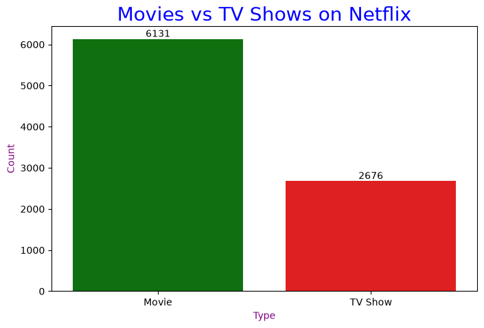
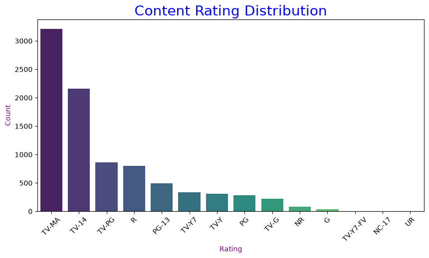
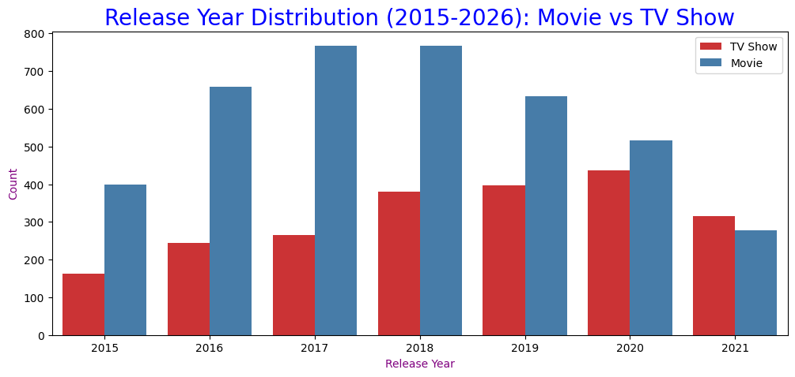
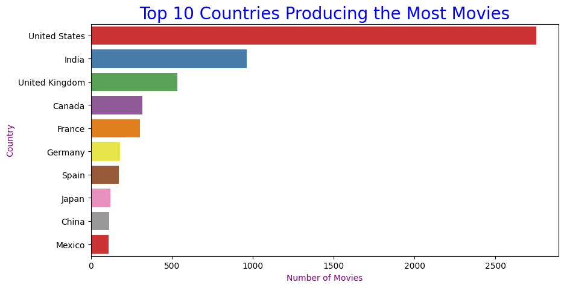
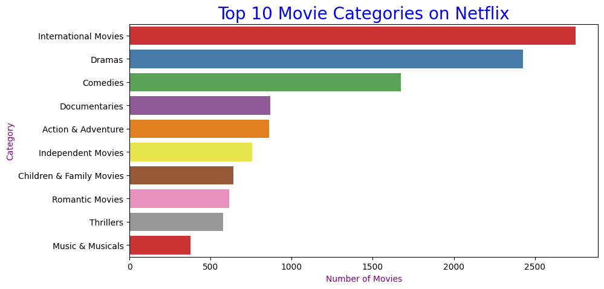

# Netflix Titles: Exploratory Data Analysis (EDA)

An exploratory data analysis of the Netflix titles dataset (as of 2021). The notebook cleans the raw data and then answers five questions about the Netflix catalog using charts: what kind of content it has, how it is rated, how it has grown over the years, and which countries and genres lead.

## Project Structure

```
Netflix Data EDA/
├── netflix_titles_2021.csv   # Raw dataset (8,807 titles)
├── Netflix Data.ipynb        # Cleaning + EDA notebook
└── Graph/                    # Exported charts (Graph1.png ... Graph5.png)
```

## Dataset

8,807 titles and 12 columns, covering both movies and TV shows added to Netflix up to 2021.

| Column | Description |
|---|---|
| `show_id` | Unique ID of the title |
| `type` | Movie or TV Show |
| `title` | Title name |
| `director` | Director(s) |
| `cast` | Cast members |
| `country` | Country or countries of production |
| `date_added` | Date the title was added to Netflix |
| `release_year` | Original release year |
| `rating` | Content rating (e.g. TV-MA, PG-13) |
| `duration` | Length in minutes (movies) or seasons (TV shows) |
| `listed_in` | Genres / categories |
| `description` | Short summary of the title |

## 1. Data Cleaning

Missing values in the raw data: `director` (2,634), `country` (831), `cast` (825), `date_added` (10), `rating` (4), `duration` (3).

| Problem | How it was handled |
|---|---|
| 3 titles had their duration (e.g. "74 min") stored in the `rating` column | Moved the value into `duration` and set `rating` to missing |
| Missing `director`, `cast`, `country` | Filled with `Unknown` |
| Missing `rating` (7 after the fix above) | Filled with the most frequent rating (**TV-MA**) |
| `date_added` stored as text | Converted to datetime; new `year_added` column created |
| Duplicates | Checked and none found |

## 2. Analysis & Findings

| # | Question | Chart | Result |
|---|---|---|---|
| 1 | Movies vs TV Shows | `Graph1.png` | 6,131 movies and 2,676 TV shows, so about 70% of the catalog is movies |
| 2 | Content rating distribution | `Graph2.png` | **TV-MA** is the most common rating (3,207), followed by TV-14 (2,160) and TV-PG (863) |
| 3 | Releases per year, 2015 onward, by type | `Graph3.png` | Movies outnumber TV shows every year from 2015 to 2020. In 2021 (a partial year in the data) TV shows are ahead, 315 to 277 |
| 4 | Top 10 countries producing movies | `Graph4.png` | United States (2,752), India (962), United Kingdom (534), Canada (319), France (303) lead the list |
| 5 | Top 10 movie categories | `Graph5.png` | International Movies (2,752), Dramas (2,427), Comedies (1,674), Documentaries (869), Action & Adventure (859) |

Notes on the method:
- For countries and genres, multi-value cells (e.g. `"United States, India"`) are split and counted once per country or genre, so one movie can appear in several counts.
- `Unknown` countries are excluded from the top-10 country chart.

## Graph Gallery

| | |
|---|---|
|  |  |
|  |  |
|  | |

## Tech Stack

- Python 3
- Pandas, NumPy
- Matplotlib, Seaborn
- Jupyter Notebook

## How to Run

1. Clone or download this project.
2. Install the requirements:
   ```bash
   pip install pandas numpy matplotlib seaborn jupyter
   ```
3. Start Jupyter and open the notebook:
   ```bash
   jupyter notebook "Netflix Data.ipynb"
   ```
4. Run all cells. It reads `netflix_titles_2021.csv` and draws all charts.

> Keep the notebook and the CSV file in the same folder so the relative file path works.

## Author

*Your name here*
